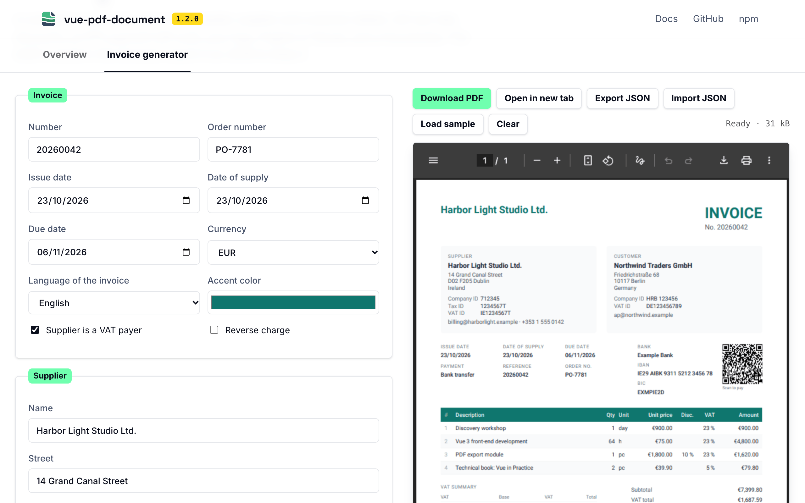
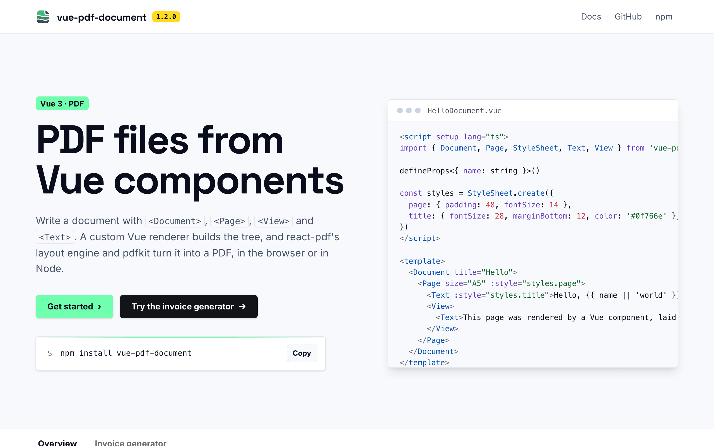
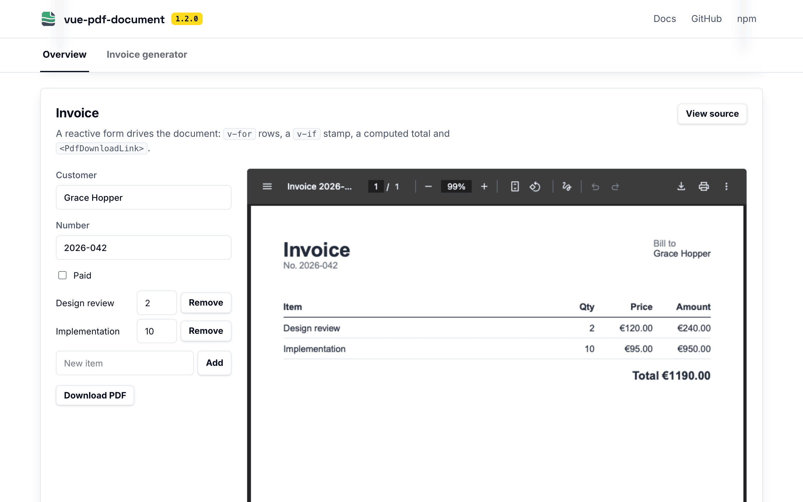
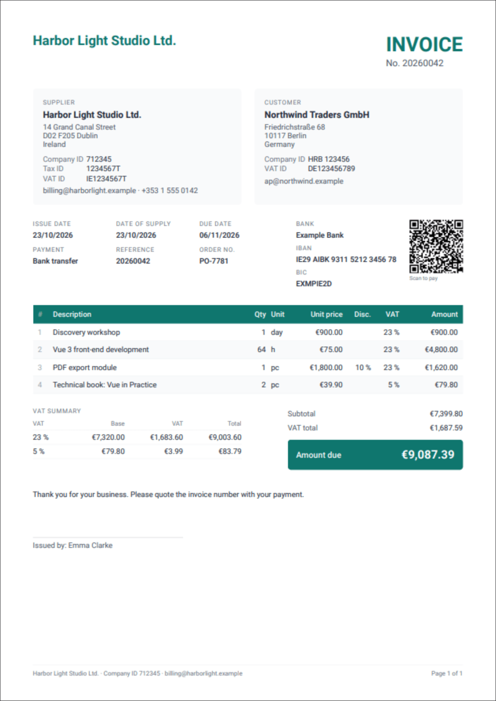

<p align="center">
  
</p>

# vue-pdf-document

[](https://www.npmjs.com/package/vue-pdf-document) [](https://github.com/jantursky/vue-pdf-document/actions/workflows/ci.yml) [](https://www.npmjs.com/package/vue-pdf-document) [](https://github.com/jantursky/vue-pdf-document/blob/main/LICENSE) [](https://codecov.io/gh/jantursky/vue-pdf-document) [](https://bundlejs.com/?q=vue-pdf-document&config=%7B%22esbuild%22%3A%7B%22external%22%3A%5B%22vue%22%2C%22%40react-pdf/%2A%22%2C%22pdfkit%22%5D%7D%7D)

[Docs](https://vue-pdf-document-docs.vercel.app) · [Demo](https://vue-pdf-document.vercel.app) · [npm](https://www.npmjs.com/package/vue-pdf-document) · [Changelog](packages/vue-pdf-document/CHANGELOG.md)

Create PDF files with Vue 3 components. This repository holds the library, a demo app and the docs site.

<a href="https://vue-pdf-document.vercel.app/#generator"><picture><source media="(prefers-color-scheme: dark)" srcset=".github/assets/generator-dark.png" /></picture></a>

<p>
  <a href="https://vue-pdf-document.vercel.app"><picture><source media="(prefers-color-scheme: dark)" srcset=".github/assets/overview-dark.png" /></picture></a>
  <a href="https://vue-pdf-document.vercel.app/#example-invoice"><picture><source media="(prefers-color-scheme: dark)" srcset=".github/assets/examples-dark.png" /></picture></a>
</p>

| folder                      | what it is                                                                                       |
| --------------------------- | ------------------------------------------------------------------------------------------------ |
| `packages/vue-pdf-document` | The library, published to npm. Its [README](packages/vue-pdf-document/README.md) covers the API. |
| `apps/example`              | The demo app: examples with their source, and an invoice generator on its own tab.               |
| `apps/docs`                 | The docs site, built with [Blume](https://www.npmjs.com/package/blume).                          |

## Invoice generator

The demo's second tab ([`#generator`](https://vue-pdf-document.vercel.app/#generator)) is a complete invoice tool built on one template, `apps/example/src/generator/InvoiceTemplate.vue`:

- supplier and customer with company, tax and VAT IDs, dates of issue, supply and payment, an order number and a payment reference
- line items with units, discounts and VAT rates, a VAT recap per rate, VAT-exempt suppliers and reverse charge
- an EPC (SEPA) payment QR code for EUR transfers, drawn with `qrcode`
- a logo upload, an accent color, and English or Slovak labels with an embedded Roboto font
- a table header that repeats on every page, and page numbers in the footer
- one `usePdf()` render shared by the preview and the download, a draft saved in `localStorage`, and JSON export and import

<p align="center"></p>

## How it works

[react-pdf](https://github.com/diegomura/react-pdf) is a set of packages, and only `@react-pdf/renderer` depends on React. The layout engine (`@react-pdf/layout`, Yoga flexbox plus text shaping and pagination), the drawing step (`@react-pdf/render`), the font store (`@react-pdf/font`) and the PDF writer (pdfkit) all work on a plain tree of `{ type, props, style, children }` nodes.

So the library is a custom Vue renderer:

1. `createRenderer` from Vue builds and patches a node tree with the shape the layout engine reads (`src/core/renderer.ts`).
2. Before each render, a clean copy of that tree is made, with Vue's comment and anchor nodes dropped and `render` props wrapped so they can return vnodes (`src/core/snapshot.ts`).
3. The copy goes through `@react-pdf/layout` and `@react-pdf/render` into pdfkit, the same calls `@react-pdf/renderer` makes (`src/core/pdf.ts`).

React's reconciler is replaced by Vue's reactivity: a change to data the document reads patches the tree, and `usePdf()` renders again after a debounce.

### Prior art

Checked on 2026-10-22, before starting:

| project                                                         | approach                                         | state                                                                                                                                                                                                               |
| --------------------------------------------------------------- | ------------------------------------------------ | ------------------------------------------------------------------------------------------------------------------------------------------------------------------------------------------------------------------- |
| [`@ceereals/vue-pdf`](https://github.com/Ceereals/vue-pdf)      | Vue renderer over `@react-pdf/layout` and render | Alive but slow: 0.3.1 (March 2026), last push April 2026, 128 stars, about 2,000 downloads a month. Pins `@react-pdf/layout@^4` while upstream is on 5.2, and patches dependencies with `patch-package` on install. |
| [`vuejs-pdf`](https://www.npmjs.com/package/vuejs-pdf)          | Wrapper over `polypdf-core`                      | Effectively dead: 0.0.3 from July 2025, no license, 0 stars, about 25 downloads a month.                                                                                                                            |
| [`vue-pdf`](https://www.npmjs.com/package/vue-pdf)              | pdf.js viewer, not a generator                   | Unmaintained since 2022, Vue 2.                                                                                                                                                                                     |
| [`@react-pdf/renderer`](https://github.com/diegomura/react-pdf) | The upstream engine                              | Very active: 4.9.0 (August 2026), commits this week, about 25 million downloads a month.                                                                                                                            |

This library tracks the current upstream packages (`@react-pdf/layout` 5.x, pdfkit 0.20) without patches, ships one ESM entry for browsers, workers and Node, and keeps its own code at about 4 kB gzipped.

## Requirements

- [Bun](https://bun.sh) 1.3 or newer, for installing and running scripts.
- Node.js 22.19 or newer. Vitest's coverage and the docs build run on it, and `bun run` hands those tools to Node.

## Commands

Run these from the repository root.

```sh
bun install            # install every workspace
bun run dev            # demo app with hot reload, reading the library's source
bun run dev:docs       # docs site with hot reload
bun run build          # library with size-limit budgets, then the demo app
bun run build:docs     # library, then the docs site
bun run check          # format check, lint, typecheck, tests with coverage
bun run test:browser   # rendering in real Chromium, Firefox and WebKit
bun run test:e2e       # build the demo and drive it with Playwright in all three engines
bun run lint:package   # publint and type resolution (after build)
bun run test:pack      # install the packed tarball into an empty project and render from it (after build)
bun run sync:samples   # copy the README and docs code samples into the demo, where they're type-checked
bun run format         # format everything with Prettier
bun run lint:fix       # fix what ESLint can fix
```

`bun run build` ends with [size-limit](https://github.com/ai/size-limit) and fails if the library's own code grows past 6 kB minified and gzipped, or if the library together with the layout engine, as a browser app ships it, passes 450 kB (it's about 370 kB today). The budgets are in `packages/vue-pdf-document/.size-limit.json`, and `.github/workflows/size.yml` comments the change on every pull request. Coverage goes to [Codecov](https://codecov.io/gh/jantursky/vue-pdf-document) from CI. Coverage has minimum thresholds, so `bun run check` fails if they drop.

Tests come in seven layers:

- **Unit** (`packages/vue-pdf-document/test`, Vitest + happy-dom): the renderer, the snapshot, the components and the composable. They render real PDFs in Node and read the text, metadata and page count back out.
- **Types** (`test/types.test.ts`): `expectTypeOf` and `@ts-expect-error` assertions that `bun run typecheck` enforces.
- **Browser** (`test/browser`): pdfkit's browser build in Chromium, Firefox and WebKit, the way an app's bundler loads it.
- **End-to-end** (`apps/example/e2e`, Playwright): the built demo, with live previews, re-rendering, downloads and pagination, and the invoice generator's totals, language, QR code, logo, saved draft and JSON import.
- **Accessibility** (`apps/example/e2e/a11y.spec.ts`, axe-core): the demo's overview and generator against WCAG 2.2 A and AA, in the light and dark themes.
- **Vue versions** (CI): the library's typecheck and unit tests against Vue 3.5.0, the oldest version its peer range allows, and the newest one on npm.
- **Package** (`scripts/pack-test.js`): the tarball installed into an empty project, imported and required from plain Node.

The code samples in the package README and the getting-started page are copied into `apps/example/src/typecheck` by `bun run sync:samples` and compiled with the demo; `bun run check` fails if a copy is stale.

CI (`.github/workflows/ci.yml`) runs all of it, plus `build`, `lint:package` and `build:docs`, on pushes to `main` and on pull requests.

The browser tests need Playwright's engines once per machine: `bunx playwright install chromium firefox webkit`.

## Releasing a new version

1. Move the entries under `## [Unreleased]` in `packages/vue-pdf-document/CHANGELOG.md` into a new section, such as `## [1.1.0] - 2026-11-03`, and add its link at the bottom. Leave an empty `## [Unreleased]` section above it.
2. Set the same version in `packages/vue-pdf-document/package.json`. The demo app and the docs read it from there.
3. Run `bun run check && bun run build:docs`, commit, and push.
4. Tag the commit and push the tag:

   ```sh
   git tag v1.1.0
   git push origin v1.1.0
   ```

   `.github/workflows/release.yml` checks that the tag matches the version, runs every test suite, publishes to npm with [provenance](https://docs.npmjs.com/generating-provenance-statements), and creates a GitHub release from the changelog section.

The workflow publishes through npm's [trusted publishing](https://docs.npmjs.com/trusted-publishers), so no token is stored in the repository. Set it up once on npmjs.com under the package's **Settings → Trusted publisher**: GitHub Actions, repository `jantursky/vue-pdf-document`, workflow `release.yml`, environment `npm`. The very first version has to be published by hand, since the package must exist before a trusted publisher can be added.

To publish by hand instead, run from the package folder. `prepublishOnly` runs the typecheck, both test suites, the build, the package checks and the tarball test first, and stops the publish if any fail:

```sh
cd packages/vue-pdf-document
bun publish --access public
```

Versions follow semantic versioning: a breaking change needs a new major version, listed under **Changed** in the changelog.

## Deploying to Vercel

The demo app and the docs deploy as two separate Vercel projects from the same repository. Both build the library from source first, so neither depends on a published npm version.

### Demo app

1. In Vercel, choose **Add New → Project** and import the repository.
2. Leave **Root Directory** at the repository root.
3. Leave the build settings alone. `vercel.json` at the root sets them:
   - install: `bun install --frozen-lockfile`
   - build: `bun run build`
   - output: `apps/example/dist`
4. Under **Settings → Build and Deployment**, set **Node.js Version** to 22.x.
5. Deploy.

### Docs site

1. Import the same repository again as a second project.
2. Set **Root Directory** to `apps/docs`.
3. Keep **Include source files outside of the Root Directory in the Build Step** turned on (it's the default). The build needs the library and the demo's example files.
4. Leave the build settings alone. `apps/docs/vercel.json` sets them:
   - install: `bun install --frozen-lockfile`, run from the repository root
   - build: `bun run build:docs`, run from the repository root
   - output: `dist`
5. Set **Node.js Version** to 22.x, as for the demo app.
6. Deploy. Blume picks up the production domain from Vercel's environment, so the sitemap and social cards get absolute URLs without extra config.

### From the command line

With the [Vercel CLI](https://vercel.com/docs/cli) installed and logged in:

```sh
vercel link              # once, at the repository root, for the demo project
vercel                   # preview deployment
vercel --prod            # production deployment

cd apps/docs
vercel link              # once, for the docs project
vercel --prod
```

After the first setup, every push to `main` deploys to production and every pull request gets a preview URL.

## Contributing

See [CONTRIBUTING.md](CONTRIBUTING.md). Security issues go through [SECURITY.md](SECURITY.md), and everyone involved follows the [code of conduct](CODE_OF_CONDUCT.md).

## License

MIT. The layout engine and renderer come from [react-pdf](https://github.com/diegomura/react-pdf) (MIT).
